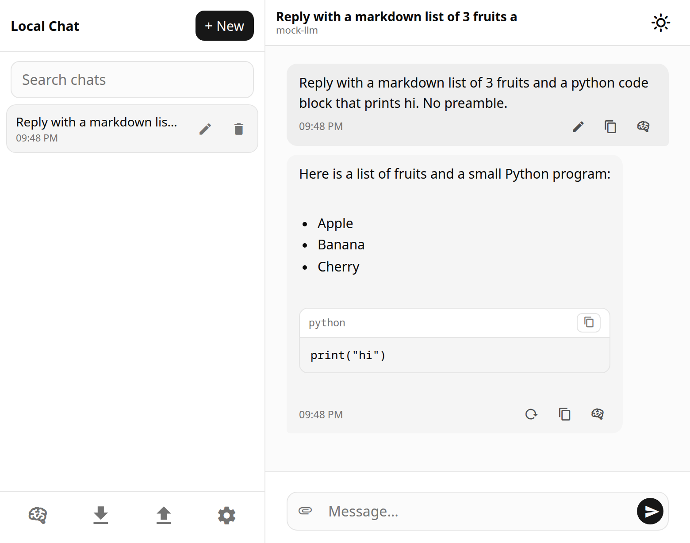

# Local Web Chat



A small, fast, self-hosted chat UI for a **locally served LLM**. No build step,
no dependencies — just Node and a browser. The whole frontend runs on the
machine and the conversation never leaves it.

## Quick start

```bash
./start.sh                     # serves the UI on http://localhost:3000
```

`start.sh` is the only entry point you need: it runs `node server.js` plus the
built-in mock LLM (silently, on port 11435 — the Settings mock toggle decides
whether the app uses it), and stops both on Ctrl+C. It needs
nothing beyond Node; `--help` prints the supported environment variables
(`PORT`, `MOCK_PORT`, `WC_MEMORY_FILE`, `WC_ALLOW_LAN`).

Open <http://localhost:3000>. By default the app talks to an OpenAI-compatible
server at `http://127.0.0.1:8081/v1` (e.g. llama.cpp's `llama-server`).
Everything is configurable in **Settings** (works with llama.cpp, vLLM, LM
Studio, Ollama `…/v1`, …): API base URL, API key, model (auto-discovered from
`/models`), temperature, max tokens, context size, system prompt and a
thinking-mode toggle for Qwen-style models.

No model running yet? Flip **Settings → Use built-in mock LLM** and the app
talks to the always-running mock on `http://127.0.0.1:11435/v1` (the base URL
field greys out while the toggle is on).

## Features

- **Chat history in browser storage** — multiple chats with search, rename and
  delete; everything lives in `localStorage`, nothing on the server.
- **Memory** — the model saves durable facts about *you* by itself using a
  native `save_memory` tool call (it decides what matters mid-conversation);
  facts are injected into every future prompt as a dated, id-tagged list
  (`[m2 | 2026-11-05] fact`, newest first), so the model can tell which of two
  contradicting facts is newer and remove outdated ones itself with
  `forget_memory` (by id or wording). The Memory panel also shows per-fact
  dates. Facts appear as a "remembered" badge — and each save/forget surfaces
  as a pill in the reply's process strip — and stay manageable in the panel
  (manual add, per-chat extraction, forget).
  Memories are persisted to a plain JSON file on the server (`memories.json`,
  override with `WC_MEMORY_FILE`) — that file is the **only** store: the
  browser keeps no copy, so editing or backing it up by hand always wins. A
  **Save to file** button in the panel forces the full list to disk right away;
  if the server is unreachable it downloads a `memories.json` copy instead, so
  the in-session list always reaches a real file. A fallback post-reply extractor
  exists for models without tool support.
- **Streaming** responses (SSE) with a Stop button that aborts upstream
  generation too.
- **MCP tools** — the model can search the web and read pages mid-conversation
  via [Model Context Protocol](https://modelcontextprotocol.io) servers: out of
  the box `ddg-search` (DuckDuckGo search/fetch, needs `uvx`). Servers are
  declared in `mcp.json`, spawned lazily as local stdio subprocesses, and each
  tool is offered to the model as `server__tool`; results are fed back in an
  agentic loop. A server that fails to start only loses its own tools.
  **Process strip** — every reply shows what the model actually did, in the
  order it did it: collapsible *Thinking* blocks interleaved with a labelled
  pill per tool call (web search *and* save/forget memory), so a
  search → reason → answer chain reads top-to-bottom instead of one merged
  blob. Pills carry a query preview, shimmer while a call runs, turn red if it
  fails, and stay with the message (the timeline is stripped from the history
  sent back to the model).
- **Attachments: images + text documents** — a paperclip (or paste, or drag &
  drop) stages up to 6 files as removable chips above the composer. Images are
  downscaled to a JPEG (max side and file-size caps configurable in Settings)
  **in the browser** (never a server) and sent to
  vision-capable models as OpenAI `image_url` parts; `.txt`/`.md`/code files are
  read as text and inlined into the prompt up to a configurable character cap,
  so even non-vision models can read
  them. Thumbnails stay in proportion (several images lay side by side) and
  documents get an expandable preview, all inside the message bubble;
  attachments persist in `localStorage` with the chats.
- **Mobile-first responsive UI** — drawer sidebar on phones, safe-area aware,
  16 px inputs (no iOS zoom), touch targets ≥ 40 px.
- Markdown rendering (XSS-safe, own mini-renderer) with copy buttons on code
  blocks, regenerate reply, per-message copy. Every bubble carries a quiet
  send-time stamp — just the time today, `Nov 16, 13:34` this year, the year
  added once it's older; hover for the full timestamp.
- **Edit your message, re-grow the chat** — a pencil on any user message edits
  it in place; saving drops everything after it and the model answers anew, so
  the rest of the conversation re-grows from the corrected prompt.
- JSON **export/import** of all chats + memories.
- **Privacy:** the built-in proxy only accepts **localhost** LLM endpoints
  (`WC_ALLOW_LAN=1` relaxes it to private LAN ranges for when the model runs
  on another box). The proxy exists purely to avoid CORS — the browser cannot
  reach the LLM directly from another origin.

## Architecture

```
start.sh               launcher: app + optional mock LLM, one Ctrl+C stops both
server.js              static file server + localhost-only LLM proxy (streams SSE)
                       + /api/memory JSON-file storage for memories
                       + /api/mcp/{tools,call} bridge for MCP servers
mcp.json               MCP server definitions: {"mcpServers": {name: {command, args, env}}}
mcp.js                 zero-dep MCP stdio client: spawn, JSON-RPC, tool registry
public/
  index.html, style.css
  js/
    main.js            entry: module wiring + boot
    events.js          event bus (data layer <-> UI decoupling)
    state.js           single app state + defaults
    storage.js         the ONLY place that touches localStorage
    chats.js           chat CRUD (persists + emits events)
    llm.js             transport: /api/chat streaming, /api/models + /api/mcp
                       discovery, MCP tool calls
    memory.js          memory domain: dedup, save_memory tool, extractors
    attachments.js     file -> message-record ingestion (canvas downscale, text caps)
    turn.js            one user turn: prompt assembly + agentic tool loop
    session.js         send-flow service (stream, stop, errors) — UI hooks injected
    io.js              export/import backups
    ui/                dom, header, messages, sidebar, composer, settings,
                       memoryPanel, markdown (pure view layer)
test/
  cdp-suite.mjs        end-to-end browser suite via Chrome DevTools Protocol
  mock-mcp-server.js   deterministic MCP stdio server used by the suite
  smoke-mock.sh        curl smoke test for mock-llm.js
mock-llm.js            OpenAI-compatible fake server for testing without a GPU
```

## Testing

```bash
# 1) mock LLM smoke test (no browser):
bash test/smoke-mock.sh

# 2) full browser suite (needs Chromium; reuses a CDP browser if one is up):
./test/run.sh                              # app :3000, mock LLM :11435
APP_PORT=3100 MOCK_PORT=11436 ./test/run.sh   # free ports while a dev instance runs
```

`test/run.sh` owns the server it tests: it refuses to start if the app or mock
port already answers, because the suite wipes the server's memory file as its
first step. That memory always goes to a throwaway temp file — and the suite
itself refuses to run unless the runner hands it `WC_TEST_MEM_FILE` and the app
confirms it writes exactly that file. It drives **only** the mock LLM and a
deterministic mock MCP server (`test/mock-mcp-server.js`), never the real
`mcp.json`, so it is deterministic and needs no GPU and no network.
To try the same flow by hand, run `./start.sh` and flip the **Use built-in mock
LLM** toggle in Settings (the mock listens on `http://127.0.0.1:11435/v1`).

## Notes

- Chats are stored per browser profile; use Export before clearing data.
- Memories live **only** in **`memories.json`** next to `server.js` — the
  browser keeps no copy, so clearing site data never touches them and the file
  is the single source of truth (facts are unavailable only while the server
  cannot serve it). Point `WC_MEMORY_FILE=/path/to/file.json` at another
  location (or a mounted volume) to keep them elsewhere. The file is plain JSON
  and can be edited while the app is stopped; the Memory panel shows its full
  path.
- The proxy rejects non-local targets, so the page can never be tricked into
  hitting arbitrary URLs.
- **MCP:** `mcp.json` next to `server.js` declares stdio MCP servers
  (`command`, `args`, optional `env`). Override the path with `WC_MCP_CONFIG`;
  an empty `mcpServers` disables the feature. The shipped `ddg-search` entry
  runs `uvx duckduckgo-mcp-server` (install [uv](https://docs.astral.sh/uv/)
  for it), which gives the model `search`, `fetch_content` and `expand_link`.
  Its `PYTHONWARNINGS=ignore::UserWarning` hides the MCP SDK's
  `MCPDeprecationWarning` (the SDK deprecates `ctx.info`, so every search logs
  one). Keep a **builtin** category there: a dotted path such as
  `mcp.shared.exceptions.MCPDeprecationWarning` is not importable when the
  interpreter starts, so CPython drops the filter and prints
  `Invalid -W option ignored` instead.
  Settings → **MCP servers** lists every configured server with its tools;
  uncheck one and save to stop offering its tools (it is not even started).
  Whatever the model searches is visible in the conversation. Treat `mcp.json`
  like `server.js` itself: only define servers you chose to run.
